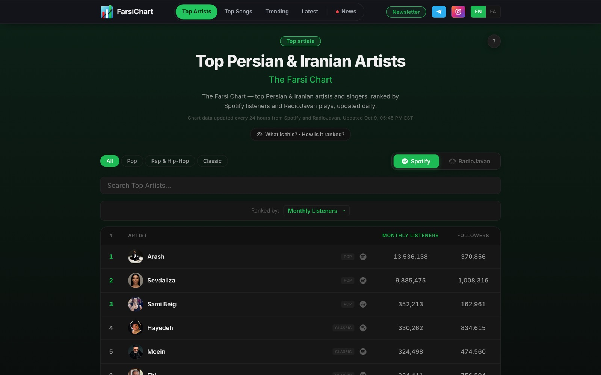
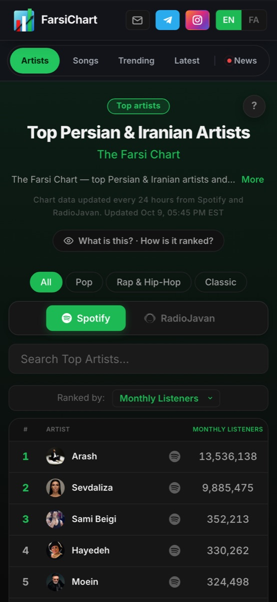
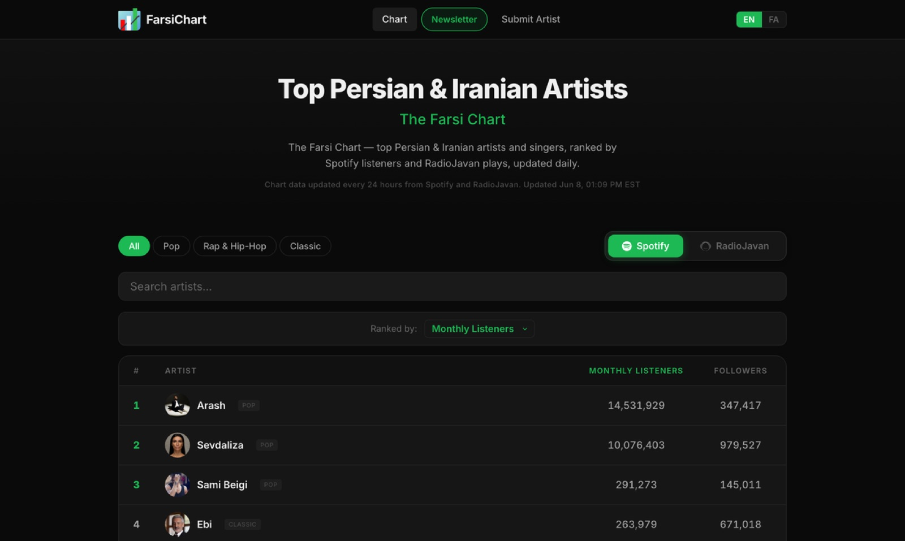

# FarsiChart

**I created, designed and built FarsiChart, an English and Persian music-data platform with 100K+ visitors a month that tracks 27,000+ songs and writes, designs and posts its own stories every day.**

| Role | Platform | Live |
|:--|:--|:--|
| Creator and owner: design, data and the build | Responsive web in English and Persian (right to left), plus auto-posted Telegram and Instagram cards | [FarsiChart.com](https://farsichart.com) · [Full case study](https://bardia.dev/work/farsichart.html) |

## The problem
A daily music newsroom in two languages with no editors. Every chart move has to become a story in English and Persian and land on Telegram and Instagram the same day. The hard part is design: a native reader spots machine-made Persian in a second, and a correct number in the wrong reading order reads as nonsense.

## What I designed
- **A bilingual chart system** that ranks Persian and Iranian artists by streaming data, built Persian-first: right-to-left layouts, Persian digits and the phrases people actually search.
- **A story engine** that turns the day's moves into designed cards and posts them, 15 bilingual stories a day.
- **Search growth** driven by real search data, so the headlines match how readers really talk.

<table><tr>
<td width="35%"></td>
<td width="65%"></td>
</tr></table>

## Results
- **100K+ visitors a month**
- **27,000+ songs** tracked in the catalogue
- **93%** of search clicks land on Persian pages
- **15 bilingual stories a day**, written, designed and posted by the engine

> **About the code:** FarsiChart's code is private, so this repository holds the case study only.

[Bardia Zadeh](https://bardia.dev) · Georgia Tech M.S. in Computer Science (HCI)
